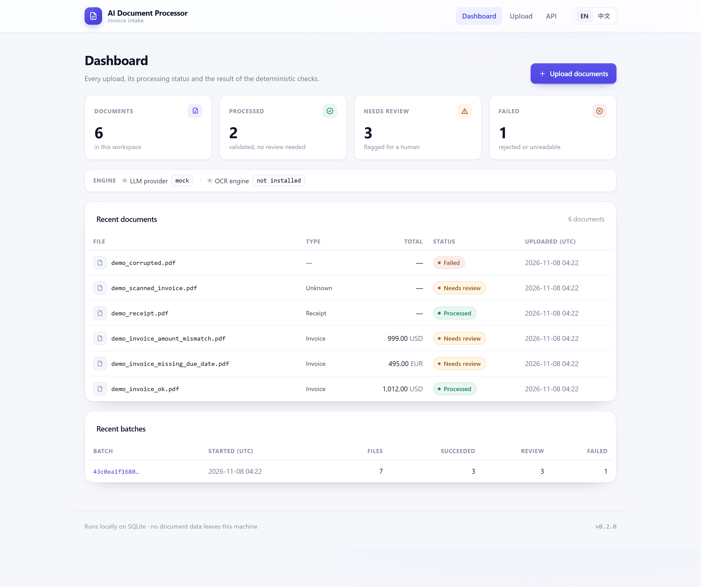
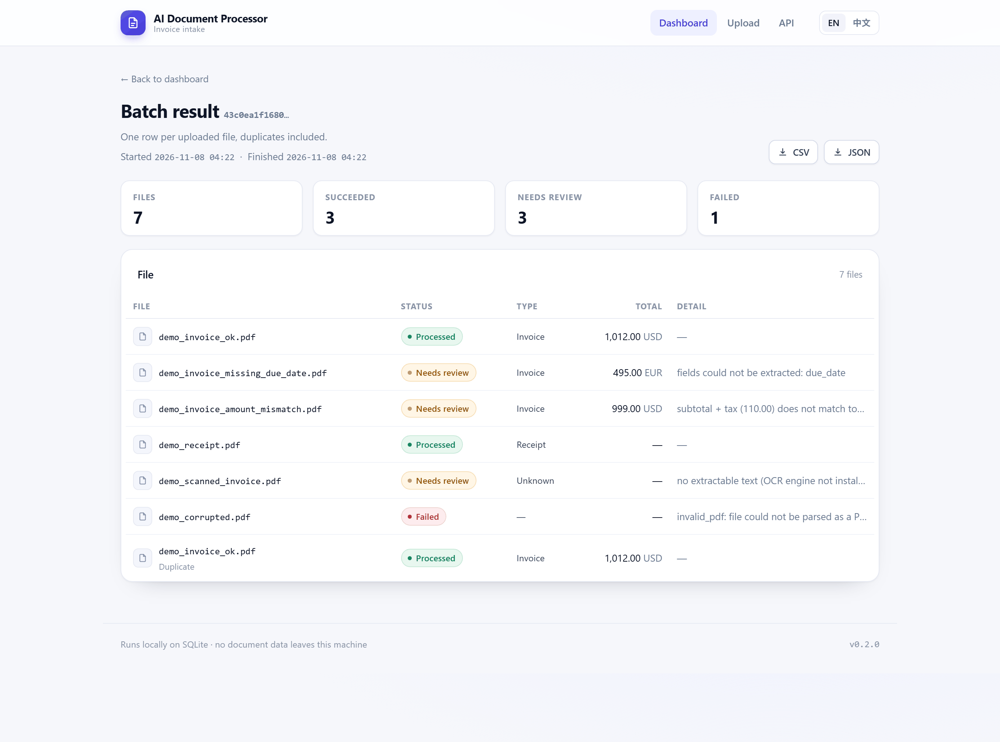
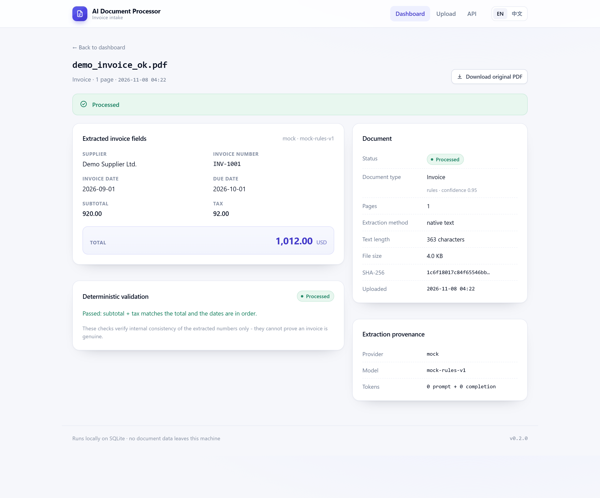
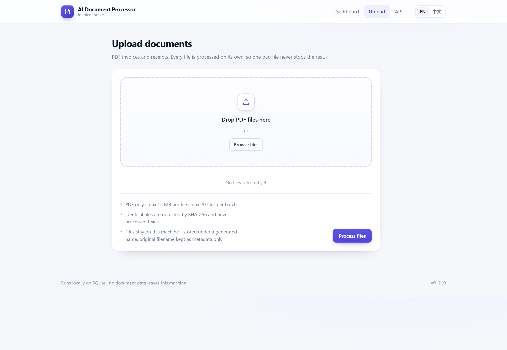

# Invoice Extractor

**Upload invoice PDFs, get structured data you can actually trust — or an explicit "needs review".**

A small, fully runnable document-processing service: validate → extract text → classify → extract
invoice fields with an LLM → validate deterministically → store in SQLite → export CSV/JSON. It runs
offline out of the box, every automated test included.

English | [简体中文](README.zh-CN.md)

[](https://github.com/taozhihaoo/invoice-extractor/actions/workflows/ci.yml)




> **Independent portfolio project.** Self-contained and built to demonstrate real, working software —
> not a client deliverable and not a production system. No real invoices, companies or personal data
> exist anywhere in this repository; all samples are synthetic.

## What it does

Drop in a batch of invoice PDFs. Each file is tracked individually and ends in exactly one state:
`processed`, `needs_review` or `failed`. Nothing is silently accepted — extracted data is checked
against arithmetic and date-order rules, and anything incomplete or inconsistent is flagged with the
concrete reason instead of being passed downstream.

Everything is deterministic and offline by default: the demo and the whole test suite use a
`MockLLMClient`, so **no OpenAI API key is needed** to run, test or evaluate this project.

## Features

- **Upload validation** — extension, MIME type, size, empty file, PDF magic bytes, page count,
  filename sanitisation; bodies are read in 64 KB chunks with a hard cap, so an oversized upload is
  rejected instead of being buffered in memory
- **Text extraction** — native text via PyMuPDF; OCR fallback (Tesseract) only when the text yield is
  too low *and* an OCR engine is installed
- **Classification** — `invoice` / `receipt` / `unknown` from weighted keyword rules, with a
  confidence computed from matched evidence (never invented)
- **LLM structured extraction** — OpenAI structured outputs with a strict JSON schema; fields that are
  not printed on the document come back as `null`, never guessed
- **Deterministic validation** — `subtotal + tax ≈ total` and `invoice_date ≤ due_date`, computed in
  plain Python `Decimal`, never by the model
- **Human review queue** — `needs_review` plus explicit, human-readable `review_reasons`
- **Batch isolation** — one broken file never stops a run; even an unexpected crash is recorded as that
  file's failure and the batch continues
- **Retryable failures** — dedup only trusts *successful* results, so re-uploading a file that failed
  actually reprocesses it
- **Duplicate detection** — SHA-256 based; identical bytes never trigger a second extraction or LLM call
- **SQLite persistence** — three tables, parameterised SQL only, WAL mode for concurrent reads
- **Bilingual web UI** — server-rendered Jinja2 pages in English and Simplified Chinese, no JS framework
- **REST API** — upload, batch, list, detail, run summary, download, CSV/JSON export
- **Demo mode** — end-to-end offline run over synthetic documents in one command
- **Tests & CI** — 191 offline tests; GitHub Actions on Python 3.11 and 3.13, plus packaging and
  Docker smoke jobs

## Quickstart

Requires Python 3.11+. `OPENAI_API_KEY` is optional — without it everything runs in mock mode.

```bash
# 1. create and activate a virtual environment
python -m venv .venv
source .venv/bin/activate            # Windows: .venv\Scripts\activate

# 2. install dependencies (runtime + test tooling)
pip install -r requirements-dev.txt

# 3. verify: offline tests and lint
pytest
ruff check .

# 4. run the end-to-end demo (mock LLM, no API key, no network)
python -m src.main --demo

# 5. start the API + web UI on http://127.0.0.1:8000
python -m src.main --serve
```

## How it works

```
                  ┌──────────────────────────────────────────────────┐
 upload ─────────►│ validate (ext/MIME/size/empty/magic/pages/names) │
                  └───────────────────────┬──────────────────────────┘
                                          │ generated storage name
                                          ▼
                  ┌──────────────────────────────────────────────────┐
                  │ extraction pipeline                              │
                  │  native PDF text (PyMuPDF)                       │
                  │  └─ if text < threshold: OCR fallback (optional) │
                  └───────────────────────┬──────────────────────────┘
                                          ▼
                  ┌──────────────────────────────────────────────────┐
                  │ classification: weighted rules (LLM optional)     │
                  └───────────────────────┬──────────────────────────┘
                                          │ if invoice
                                          ▼
                  ┌──────────────────────────────────────────────────┐
                  │ LLMClient (OpenAI │ Mock) → InvoiceData (strict) │
                  └───────────────────────┬──────────────────────────┘
                                          ▼
                  ┌──────────────────────────────────────────────────┐
                  │ deterministic validation + review reasons        │
                  └──────────────┬─────────────────────┬─────────────┘
                                 ▼                     ▼
                           SQLite storage        CSV / JSON export
```

Business logic depends only on interfaces — `ExtractionPipeline` (native/OCR) and `LLMClient`
(OpenAI/Mock) — with the concrete implementations chosen in a single composition root,
`src/bootstrap.py`.

## Web UI

Server-rendered pages with a small design system in `src/api/static/app.css` — no JS framework, no
external fonts or CDNs, so the UI works on an air-gapped machine.

| Page | Path | What it shows |
|---|---|---|
| Dashboard | `/` | Counts by status, recent documents, recent batches, active provider/OCR state |
| Upload | `/upload` | Drag-and-drop multi-file form with limits, dedup and privacy notes |
| Batch result | `/runs/{id}/view` | One row per uploaded file (duplicates included), per-run exports |
| Document | `/documents/{id}/view` | Extracted fields, validation result, review reasons, provenance |

Every page is available in English and Simplified Chinese — switch with the `EN / 中文` toggle; the
choice is remembered in a cookie (and can be forced with `?lang=en` / `?lang=zh`).







## REST API

Interactive docs: `http://127.0.0.1:8000/docs` (Swagger UI).

| Method | Path | Purpose |
|---|---|---|
| GET | `/health` | status, version, active LLM provider, OCR availability |
| POST | `/documents` | upload + process one PDF (201; 200 + `duplicate: true` for a known file) |
| POST | `/documents/batch` | upload + process several PDFs as one run |
| GET | `/documents` | list documents (paginated) |
| GET | `/documents/{id}` | full result: fields, validation, review reasons, LLM usage |
| GET | `/documents/{id}/download` | original stored PDF |
| GET | `/runs/{run_id}` | batch summary + per-file results |
| GET | `/export/csv` | `invoice_report.csv` (optional `?run_id=`) |
| GET | `/export/json` | full structured JSON (optional `?run_id=`) |

Errors always use `{"error": {"code": ..., "message": ...}}` — 4xx for rejected uploads, sanitised 500
for unexpected failures. Stack traces, internal paths and provider details are never returned.

Amounts in API JSON are serialised as **strings** (e.g. `"total": "999.00"`) because the extracted
values are `Decimal`s kept at full precision instead of being rounded through floats. The JSON export
(`/export/json`) writes them as JSON numbers — see `src/exporters.py`.

## CLI

```bash
python -m src.main --help          # usage
python -m src.main --demo          # offline end-to-end demo (no API key)
python -m src.main --serve         # start API + web UI
python -m src.main --process DIR   # process every PDF in a folder
python -m src.main --process FILE  # process a single PDF
python -m src.main --gen-samples D # write synthetic sample PDFs to D
```

After `pip install -e .` the same CLI is available as `invoice-extractor`.

## Configuration

Environment variables (or a `.env` file — see `.env.example`; never committed):

| Variable | Default | Purpose |
|---|---|---|
| `LLM_PROVIDER` | `auto` | `mock` / `openai` / `auto` (auto = OpenAI only if a key exists) |
| `OPENAI_API_KEY` | — | never required for demo/tests |
| `OPENAI_MODEL` | `gpt-4o-mini` | model id for structured extraction |
| `OPENAI_BASE_URL` | — | optional compatible endpoint |
| `OPENAI_TIMEOUT_SECONDS` | `30` | per-request timeout |
| `OPENAI_MAX_RETRIES` | `2` | retries for rate limits / timeouts / 5xx |
| `DATABASE_PATH` | `data/processor.db` | SQLite location |
| `UPLOAD_DIR` | `data/uploads` | stored uploads |
| `EXPORT_DIR` | `output` | CSV/JSON exports |
| `MAX_UPLOAD_SIZE_MB` | `15` | per-file upload limit |
| `MAX_PDF_PAGES` | `50` | page-count limit |
| `MAX_BATCH_FILES` | `20` | files per batch |
| `MIN_NATIVE_TEXT_CHARS` | `100` | below this, OCR is attempted if available |

## Invoice extraction

Fields: `supplier`, `invoice_number`, `invoice_date`, `due_date`, `subtotal`, `tax`, `total`,
`currency` — modelled by a Pydantic `InvoiceData`:

- dates are normalised to ISO 8601 (`YYYY-MM-DD`; day-first assumed for `DD/MM/YYYY` — a documented
  assumption)
- amounts are exact `Decimal` values, non-negative
- currency is an uppercase 3-letter code
- every field is nullable; **missing information is `null`, never invented** — enforced by the JSON
  schema, the prompt and the deterministic mock alike

### Validation and review

The deterministic layer (`src/validation_rules.py`, pure Python, no LLM) checks:

- `subtotal + tax ≈ total`, within 2 cents + 0.1 % of the total (per-line rounding tolerance)
- `due_date` is not before `invoice_date` (when both exist)

A document is marked `needs_review` with explicit reasons when a field is missing, a check fails, the
type is unknown, or no text could be extracted:

```json
{
  "needs_review": true,
  "review_reasons": [
    "fields could not be extracted: due_date",
    "subtotal + tax (110.00) does not match total (999.00)"
  ]
}
```

These checks verify **internal consistency of the extracted numbers only**. They cannot prove an
invoice is genuine, and the system never claims a model "confirmed" anything: provenance (provider,
model, token usage) is stored and displayed.

## Supported documents

- **PDF only** in v1; native text-layer PDFs are the primary target.
- Image-only ("scanned") PDFs are handled honestly: with Tesseract installed they go through OCR;
  without it they are flagged `needs_review` with `no extractable text (OCR engine not installed)`.
  The system never pretends OCR happened.
- DOCX/XLSX/EMAIL/ZIP are out of scope for v1.

## Storage and export

SQLite (file-based, zero-ops, WAL mode) with three tables:

- `documents` — sanitised filename, content type, size, SHA-256, status, type + confidence, page count,
  extraction method, text length, review reasons, timestamps
- `extractions` — the eight invoice fields, validation status + warnings, needs_review + reasons,
  provider/model/token usage
- `processing_runs` — run id, start/finish, `total / success / failed / needs_review`, upload manifest

All statements are parameterised; the schema is created idempotently on first use. Uploads are stored
under generated UUID names — an untrusted filename never becomes a filesystem path.

- **CSV** (`/export/csv`): `filename, supplier, invoice_number, invoice_date, due_date, subtotal, tax,
  total, currency, document_type, status, needs_review`
- **JSON** (`/export/json`): the full structured result per document, including warnings and reasons

## Demo mode

```bash
python -m src.main --demo
```

No API key, no network. Generates six synthetic documents (invented companies: *Demo Supplier Ltd.*,
*Acme Paper Goods Co.*, …), processes them as one batch — including a duplicate upload and a corrupted
PDF — stores everything in SQLite and writes `invoice_report.csv` / `.json` to `output/`.

Expected outcome without Tesseract: `total 7 · succeeded 3 · needs_review 3 · failed 1 · duplicates 1`.

## OpenAI integration

`src/llm/openai_client.py` uses strict JSON-schema structured outputs, an explicit timeout, and
explicit retries (rate limits honour `Retry-After`; timeouts and 5xx use exponential backoff; auth
errors fail fast). SDK exceptions are translated into an `LLMError` hierarchy so callers never import
the `openai` package, and token usage is stored per extraction.

Honest status: covered by offline tests against a fake SDK (**all automated tests run without
network**) and works end to end in mock mode, but it was **not executed against the live OpenAI API**
in the environment where this project was developed (no key configured). Set `OPENAI_API_KEY` and
`LLM_PROVIDER=openai` to run it for real.

## Testing

```bash
pytest
```

191 offline tests, plus one optional OCR integration test that auto-skips without Tesseract:

- **unit** — upload validation, filename sanitisation, file store, extraction pipeline (including the
  OCR-fallback abstraction with fakes), classification, `InvoiceData` schema, validation rules, mock
  LLM, OpenAI client (retry / rate limit / timeout / auth / bad response, fake SDK), SQLite layer,
  exporters
- **integration** — processing service, dedup and retry-after-failure, batch isolation (including an
  unexpected crash), every REST endpoint, sanitised error responses, upload size cap, all web UI pages
  in both languages, CLI and demo end to end

Every automated test is deterministic, offline (`LLM_PROVIDER=mock`) and needs neither OpenAI,
Tesseract, Docker nor network access.

## Docker

```bash
docker compose up --build     # API + UI on http://localhost:8000
```

`Dockerfile` + `docker-compose.yml` provide a non-root user, a `/health` healthcheck, volumes for
SQLite/uploads/exports, and secrets injected via environment (`.env` is never baked into the image).

The image is built and smoke-tested in CI (`docker build` → run → `/health`, UI, CSS and CSV export).
It was not built on the development machine, where Docker is unavailable. For real OCR in a container
you would add the Tesseract binary (`apt-get install tesseract-ocr`) — intentionally not bundled, to
keep the default image small.

## Project structure

```
src/
  main.py                CLI entry point (--demo / --serve / --process / --gen-samples)
  config.py              settings (env / .env), provider resolution
  bootstrap.py           composition root: settings → implementations
  errors.py              user-safe domain error hierarchy
  upload_validator.py    extension/MIME/size/empty/magic/filename checks
  file_store.py          generated-name storage + SHA-256
  validation_rules.py    deterministic consistency checks + review reasons
  database.py            SQLite schema, parameterised queries, WAL
  exporters.py           CSV / JSON export builders
  models/                enums, InvoiceData, result models
  extraction/            native PDF (PyMuPDF), OCR adapter, pipeline
  classification/        weighted-keyword rules (+ LLM fallback hook)
  llm/                   LLMClient protocol, strict schemas, OpenAI + Mock
  processing/            single-document orchestration, batch runner
  api/
    app.py               FastAPI factory, routes, error handlers
    ui.py                Jinja2 pages
    i18n.py              English / Chinese UI strings
    uploads.py           chunked upload reading with a hard size cap
    templates/           base, dashboard, upload, run, document, error
    static/              app.css, favicon
  demo/                  synthetic samples + offline demo runner
tests/
  unit/                  offline, deterministic
  integration/           API, batch, UI/i18n, CLI/demo, processing, optional OCR
docs/screenshots/        UI screenshots used by this README
```

## Security

- upload limits: size (streamed, capped while reading), MIME, extension, empty file, PDF magic bytes,
  page count
- filename sanitisation + generated storage names → path traversal is structurally impossible
  (original names are metadata only)
- parameterised SQL everywhere; column names for updates are whitelisted
- sanitised error responses: no tracebacks, no internal paths, no API keys
- API keys only via environment/`.env`; `.env`, `data/`, `uploads/`, `output/` are git-ignored
- non-root container user + healthcheck

Not implemented by design in v1: authentication, multi-tenancy, per-client rate limiting, virus
scanning, encryption at rest.

## Limitations

Stated plainly:

- PDF only; single node, single SQLite file; no auth, no multi-tenancy
- OCR needs a separate Tesseract install; accuracy on real scans is untested (evaluation used
  synthetic documents only)
- the OpenAI path is implemented and unit-tested against a fake SDK, but was not executed against the
  live API during development
- no accuracy benchmark is claimed anywhere — no "98 %" numbers
- not tested at production scale (large volumes, high concurrency, very large PDFs)
- Chinese/Japanese/RTL *document layouts* are untested (the UI itself is translated); ambiguous numeric
  dates are parsed day-first
- the Docker image was not built locally (Docker unavailable); CI builds and smoke-tests it instead

## License

MIT — see [LICENSE](LICENSE). Note: PyMuPDF is AGPL-3.0 licensed.
