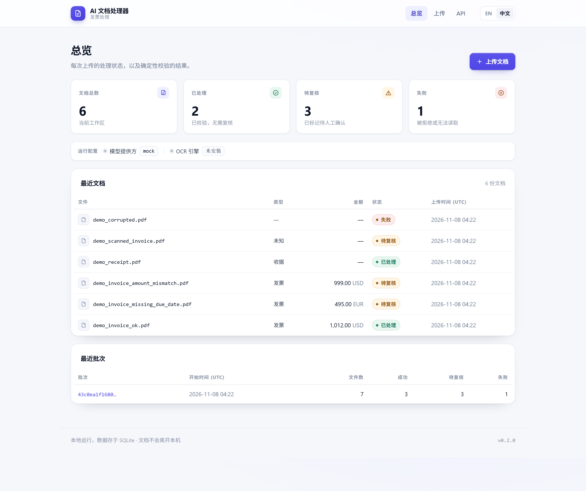
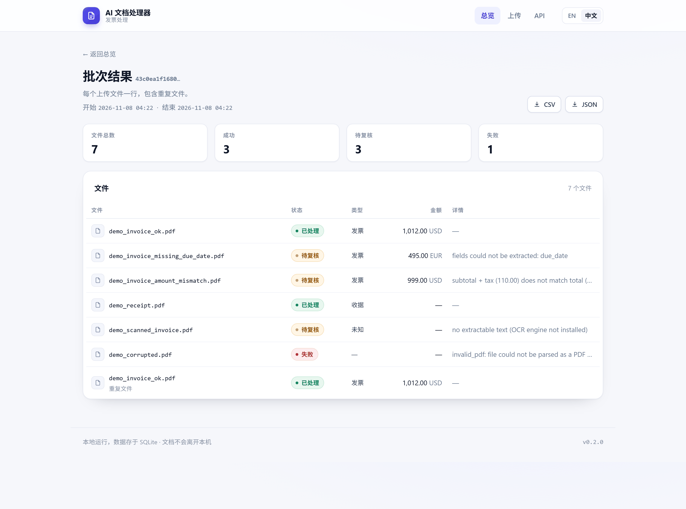
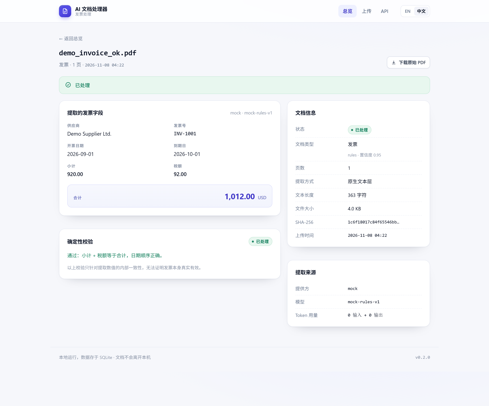
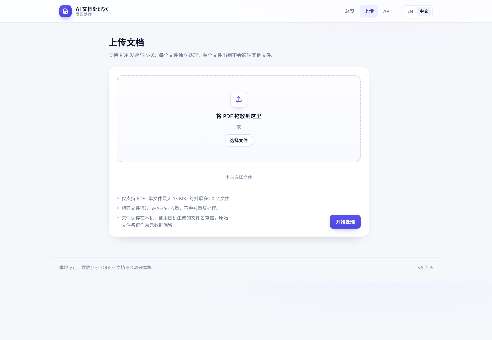

# AI 文档处理器（AI Document Processor）

**上传发票 PDF，得到可以信任的结构化数据——或者一条明确的“待人工复核”标记。**

一个可直接运行的文档处理服务：校验 → 提取文本 → 分类 → 用 LLM 抽取发票字段 → 确定性校验 →
存入 SQLite → 导出 CSV/JSON。开箱即用，全程可离线运行，包含全部自动化测试。

[English](README.md) | 简体中文

[](https://github.com/taozhihaoo/ai-document-processor/actions/workflows/ci.yml)




> **独立作品集项目。** 自包含、可运行的示例工程，用于展示真实可用的软件，而非交付给客户的产品，
> 也不是生产系统。仓库中不存在任何真实发票、公司或个人数据，所有样例均为合成数据。

## 它是做什么的

把一批发票 PDF 拖进来，每个文件都被独立跟踪，最终只会处于三种状态之一：`processed`（已处理）、
`needs_review`（待复核）、`failed`（失败）。系统不会“默默接受”：抽取出的数据都要通过金额算术与
日期顺序的检查，任何缺失或不一致的内容都会被标记，并给出具体原因，而不是继续向下游传递。

默认完全确定性、完全离线：演示模式和整个测试套件都使用 `MockLLMClient`，因此**无需 OpenAI API Key**
即可运行、测试和评估本项目。

## 功能特性

- **上传校验** —— 扩展名、MIME、大小、空文件、PDF 魔数、页数、文件名清洗；请求体按 64 KB 分块读取
  并设有硬上限，超大文件在读入阶段就被拒绝，不会撑爆内存
- **文本提取** —— 使用 PyMuPDF 提取原生文本层；仅当文本量不足**且**本机装有 OCR 引擎时，才回退到
  Tesseract OCR
- **文档分类** —— 基于加权关键词规则判断 `invoice` / `receipt` / `unknown`，置信度由命中的证据计算
  得出，而不是凭空给出
- **LLM 结构化抽取** —— OpenAI 结构化输出 + 严格 JSON Schema；文档上没有的字段返回 `null`，绝不猜测
- **确定性校验** —— `小计 + 税额 ≈ 合计`、`开票日期 ≤ 到期日`，全部用 Python `Decimal` 计算，
  不交给模型
- **人工复核队列** —— `needs_review` 状态，并附上人类可读的 `review_reasons`
- **批次隔离** —— 单个坏文件不会中断整批任务；即使是意料之外的异常，也只记为该文件的失败，批次继续
- **失败可重试** —— 去重只信任**成功**的结果，因此上次失败的文件重新上传后会被真正重新处理
- **重复检测** —— 基于 SHA-256；相同字节不会触发第二次抽取或第二次 LLM 调用
- **SQLite 持久化** —— 三张表、全部参数化 SQL、WAL 模式支持并发读取
- **中英双语 Web 界面** —— 服务端渲染的 Jinja2 页面，无 JS 框架
- **REST API** —— 上传、批量、列表、详情、批次汇总、下载、CSV/JSON 导出
- **演示模式** —— 一条命令跑完合成文档的离线端到端流程
- **测试与 CI** —— 191 个离线测试；GitHub Actions 覆盖 Python 3.11 / 3.13，并额外校验打包与
  Docker 镜像

## 快速开始

需要 Python 3.11+。`OPENAI_API_KEY` 是可选的——不配置时一切以 mock 模式运行。

```bash
# 1. 创建并激活虚拟环境
python -m venv .venv
source .venv/bin/activate            # Windows: .venv\Scripts\activate

# 2. 安装依赖（运行时 + 测试工具）
pip install -r requirements-dev.txt

# 3. 验证：离线测试与代码检查
pytest
ruff check .

# 4. 运行端到端演示（mock LLM，无需 API Key，无网络）
python -m src.main --demo

# 5. 在 http://127.0.0.1:8000 启动 API 与 Web 界面
python -m src.main --serve
```

## 工作流程

```
                  ┌──────────────────────────────────────────────────┐
 上传 ───────────►│ 校验（扩展名/MIME/大小/空文件/魔数/页数/文件名）   │
                  └───────────────────────┬──────────────────────────┘
                                          │ 生成存储文件名
                                          ▼
                  ┌──────────────────────────────────────────────────┐
                  │ 文本提取流水线                                    │
                  │  原生 PDF 文本（PyMuPDF）                         │
                  │  └─ 文本量不足阈值时：OCR 回退（可选）             │
                  └───────────────────────┬──────────────────────────┘
                                          ▼
                  ┌──────────────────────────────────────────────────┐
                  │ 分类：加权关键词规则（可选 LLM 兜底）              │
                  └───────────────────────┬──────────────────────────┘
                                          │ 若为发票
                                          ▼
                  ┌──────────────────────────────────────────────────┐
                  │ LLMClient（OpenAI │ Mock）→ InvoiceData（严格）    │
                  └───────────────────────┬──────────────────────────┘
                                          ▼
                  ┌──────────────────────────────────────────────────┐
                  │ 确定性校验 + 复核原因生成                          │
                  └──────────────┬─────────────────────┬─────────────┘
                                 ▼                     ▼
                           SQLite 存储            CSV / JSON 导出
```

业务逻辑只依赖接口——`ExtractionPipeline`（原生/OCR）与 `LLMClient`（OpenAI/Mock）——具体实现只在
一个组合根 `src/bootstrap.py` 中装配。

## Web 界面

服务端渲染页面，样式系统集中在 `src/api/static/app.css`：不依赖 JS 框架、外部字体或 CDN，因此在
完全离线的机器上也能正常显示。

| 页面 | 路径 | 内容 |
|---|---|---|
| 总览 | `/` | 各状态数量、最近文档、最近批次、当前模型与 OCR 状态 |
| 上传 | `/upload` | 支持拖拽的多文件表单，附限额、去重与隐私说明 |
| 批次结果 | `/runs/{id}/view` | 每个上传文件一行（含重复文件），以及该批次的导出入口 |
| 文档详情 | `/documents/{id}/view` | 抽取字段、校验结果、复核原因、提取来源 |

所有页面均提供英文与简体中文，用 `EN / 中文` 切换；选择会写入 Cookie 记住（也可用 `?lang=en` /
`?lang=zh` 强制指定）。







## REST API

交互式文档：`http://127.0.0.1:8000/docs`（Swagger UI）。

| 方法 | 路径 | 说明 |
|---|---|---|
| GET | `/health` | 状态、版本、当前 LLM 提供方、OCR 是否可用 |
| POST | `/documents` | 上传并处理单个 PDF（201；已知文件返回 200 + `duplicate: true`） |
| POST | `/documents/batch` | 上传并处理多个 PDF，作为一次批次 |
| GET | `/documents` | 文档列表（分页） |
| GET | `/documents/{id}` | 完整结果：字段、校验、复核原因、LLM 用量 |
| GET | `/documents/{id}/download` | 下载已存储的原始 PDF |
| GET | `/runs/{run_id}` | 批次汇总 + 逐文件结果 |
| GET | `/export/csv` | `invoice_report.csv`（可选 `?run_id=`） |
| GET | `/export/json` | 完整结构化 JSON（可选 `?run_id=`） |

错误响应统一为 `{"error": {"code": ..., "message": ...}}`：上传被拒绝返回 4xx，未预期错误返回经过
清洗的 500。堆栈、内部路径与提供方细节永不返回。

API JSON 中的金额以**字符串**形式序列化（例如 `"total": "999.00"`），因为抽取出的金额是完整精度的
`Decimal`，不希望通过浮点数被四舍五入。JSON 导出（`/export/json`）中金额为 JSON 数字，详见
`src/exporters.py`。

## 命令行

```bash
python -m src.main --help          # 用法
python -m src.main --demo          # 离线端到端演示（无需 API Key）
python -m src.main --serve         # 启动 API + Web 界面
python -m src.main --process DIR   # 处理目录下的全部 PDF
python -m src.main --process FILE  # 处理单个 PDF
python -m src.main --gen-samples D # 将合成样例 PDF 写入目录 D
```

执行 `pip install -e .` 后，同一套命令也可以通过 `document-processor` 调用。

## 配置项

环境变量（或 `.env` 文件，参考 `.env.example`；永不提交到仓库）：

| 变量 | 默认值 | 说明 |
|---|---|---|
| `LLM_PROVIDER` | `auto` | `mock` / `openai` / `auto`（auto 表示有 Key 时才用 OpenAI） |
| `OPENAI_API_KEY` | — | 演示与测试都不需要 |
| `OPENAI_MODEL` | `gpt-4o-mini` | 结构化抽取使用的模型 |
| `OPENAI_BASE_URL` | — | 可选，兼容的接口地址 |
| `OPENAI_TIMEOUT_SECONDS` | `30` | 单次请求超时 |
| `OPENAI_MAX_RETRIES` | `2` | 限流 / 超时 / 5xx 的重试次数 |
| `DATABASE_PATH` | `data/processor.db` | SQLite 位置 |
| `UPLOAD_DIR` | `data/uploads` | 上传文件存储目录 |
| `EXPORT_DIR` | `output` | CSV/JSON 导出目录 |
| `MAX_UPLOAD_SIZE_MB` | `15` | 单文件上传上限 |
| `MAX_PDF_PAGES` | `50` | PDF 页数上限 |
| `MAX_BATCH_FILES` | `20` | 单批次文件数上限 |
| `MIN_NATIVE_TEXT_CHARS` | `100` | 低于此值时尝试 OCR（若可用） |

## 发票字段抽取

字段包括：`supplier`、`invoice_number`、`invoice_date`、`due_date`、`subtotal`、`tax`、`total`、
`currency`，由 Pydantic 模型 `InvoiceData` 约束：

- 日期统一为 ISO 8601（`YYYY-MM-DD`；对 `DD/MM/YYYY` 这类歧义格式假定“日在前”，这是明确的假设）
- 金额为精确的 `Decimal`，非负
- 币种为大写三字母代码
- 所有字段均可为空；**缺失信息就是 `null`，绝不编造**——由 JSON Schema、提示词与确定性 mock
  三处共同保证

### 校验与复核

确定性校验层（`src/validation_rules.py`，纯 Python，不调用模型）会检查：

- `小计 + 税额 ≈ 合计`，容差为 2 分 + 合计的 0.1%（用于吸收逐行四舍五入）
- 当两个日期都存在时，`到期日` 不早于 `开票日期`

出现字段缺失、校验不通过、类型无法判定或完全没有可提取文本时，文档会被标记为 `needs_review`，
并给出具体原因：

```json
{
  "needs_review": true,
  "review_reasons": [
    "fields could not be extracted: due_date",
    "subtotal + tax (110.00) does not match total (999.00)"
  ]
}
```

> 复核原因由后端生成，因此保持英文，便于日志、导出与排查时保持一致的机器可读性。

这些检查只验证**抽取数值的内部一致性**，无法证明发票本身真实有效；系统也从不声称模型“确认”了
数据——提供方、模型与 Token 用量都会被记录并展示。

## 支持的文档

- v1 仅支持 **PDF**，主要面向带原生文本层的 PDF。
- 纯图片（扫描件）PDF 会被诚实处理：本机装有 Tesseract 时走 OCR；没有时标记为 `needs_review`，
  原因为 `no extractable text (OCR engine not installed)`。系统绝不假装做过 OCR。
- DOCX/XLSX/EMAIL/ZIP 不在 v1 范围内。

## 存储与导出

SQLite（单文件、零运维、WAL 模式），三张表：

- `documents` —— 清洗后的文件名、内容类型、大小、SHA-256、状态、类型与置信度、页数、提取方式、
  文本长度、复核原因、时间戳
- `extractions` —— 八个发票字段、校验状态与警告、needs_review 与原因、提供方/模型/Token 用量
- `processing_runs` —— 批次 ID、开始与结束时间、`total / success / failed / needs_review`、
  上传清单

全部语句参数化；表结构在首次使用时幂等创建。上传文件以随机 UUID 命名存储——不可信的文件名永远
不会变成文件系统路径。

- **CSV**（`/export/csv`）：`filename, supplier, invoice_number, invoice_date, due_date, subtotal,
  tax, total, currency, document_type, status, needs_review`
- **JSON**（`/export/json`）：每个文档的完整结构化结果，含警告与复核原因

## 演示模式

```bash
python -m src.main --demo
```

不需要 API Key，也不需要网络。它会生成 6 个合成文档（虚构公司：*Demo Supplier Ltd.*、
*Acme Paper Goods Co.* 等），作为一次批次处理——其中包含一个重复上传和一个损坏的 PDF——写入
SQLite，并在 `output/` 下生成 `invoice_report.csv` / `.json`。

在未安装 Tesseract 的情况下，预期结果为：
`total 7 · succeeded 3 · needs_review 3 · failed 1 · duplicates 1`。

## OpenAI 集成

`src/llm/openai_client.py` 使用严格 JSON Schema 结构化输出、显式超时与显式重试策略（限流会遵循
`Retry-After`，超时与 5xx 使用指数退避，鉴权错误立即失败）。SDK 异常被翻译为 `LLMError` 体系，
调用方无需 import `openai`；每次抽取都会记录 Token 用量。

诚实说明：该集成由基于假 SDK 的离线测试覆盖（**所有自动化测试均不联网**），并在 mock 模式下端到端
可用，但**未在开发环境对真实 OpenAI API 执行过**（当时没有可用 Key）。配置 `OPENAI_API_KEY` 与
`LLM_PROVIDER=openai` 即可真实运行。

## 测试

```bash
pytest
```

191 个离线测试，另有 1 个可选 OCR 集成测试（未安装 Tesseract 时自动跳过）：

- **单元测试** —— 上传校验、文件名清洗、文件存储、提取流水线（含用 fake 验证的 OCR 回退抽象）、
  分类、`InvoiceData` 结构、校验规则、mock LLM、OpenAI 客户端（重试 / 限流 / 超时 / 鉴权 / 异常
  响应，使用假 SDK）、SQLite 层、导出器
- **集成测试** —— 处理服务、去重与失败重试、批次隔离（含未预期异常）、全部 REST 端点、错误响应
  清洗、上传体积上限、双语 Web 页面、CLI 与演示端到端

所有自动化测试都是确定性的、离线的（`LLM_PROVIDER=mock`），不需要 OpenAI、Tesseract、Docker 或
网络。

## Docker

```bash
docker compose up --build     # API 与界面在 http://localhost:8000
```

`Dockerfile` + `docker-compose.yml` 提供非 root 用户、`/health` 健康检查、SQLite/上传/导出的数据卷，
密钥通过环境变量注入（`.env` 不会被打进镜像）。

镜像在 CI 中完成构建与冒烟测试（`docker build` → 启动 → 校验 `/health`、页面、CSS 与 CSV 导出）。
开发机未安装 Docker，因此没有本地构建过。若需要在容器内使用真实 OCR，需额外安装 Tesseract
（`apt-get install tesseract-ocr`）——出于镜像体积考虑默认不内置，未安装时扫描件会按上文所述进入
复核。

## 项目结构

```
src/
  main.py                CLI 入口（--demo / --serve / --process / --gen-samples）
  config.py              配置（env / .env）与提供方解析
  bootstrap.py           组合根：配置 → 具体实现
  errors.py              对用户安全的领域错误体系
  upload_validator.py    扩展名/MIME/大小/空文件/魔数/文件名校验
  file_store.py          生成名存储 + SHA-256
  validation_rules.py    确定性一致性校验 + 复核原因
  database.py            SQLite 表结构、参数化查询、WAL
  exporters.py           CSV / JSON 导出构建
  models/                枚举、InvoiceData、结果模型
  extraction/            原生 PDF（PyMuPDF）、OCR 适配器、流水线
  classification/        加权关键词规则（+ LLM 兜底钩子）
  llm/                   LLMClient 协议、严格 Schema、OpenAI + Mock
  processing/            单文档编排、批次执行
  api/
    app.py               FastAPI 工厂、路由、错误处理
    ui.py                Jinja2 页面
    i18n.py              中英文界面文案
    uploads.py           带硬上限的分块上传读取
    templates/           base、dashboard、upload、run、document、error
    static/              app.css、favicon
  demo/                  合成样例 + 离线演示执行器
tests/
  unit/                  离线、确定性
  integration/           API、批次、UI/国际化、CLI/演示、处理服务、可选 OCR
docs/screenshots/        本 README 使用的界面截图
```

## Security

- upload limits: size (streamed and capped while reading), MIME, extension, empty file, PDF magic
  bytes, page count
- filename sanitisation + generated storage names → path traversal is structurally impossible
  (original names are metadata only)
- parameterised SQL everywhere; column names used in updates are whitelisted
- sanitised error responses: no tracebacks, no internal paths, no API keys
- API keys only via environment/`.env`; `.env`, `data/`, `uploads/`, `output/` are git-ignored
- non-root container user + healthcheck

Not implemented by design in v1: authentication, multi-tenancy, per-client rate limiting, virus
scanning, encryption at rest.

## Limitations

- PDF only; single node, single SQLite file; no auth, no multi-tenancy
- OCR needs a separate Tesseract install; accuracy on real scans is untested (evaluation used
  synthetic documents only)
- the OpenAI path is implemented and unit-tested against a fake SDK, but was not executed against the
  live API during development
- no accuracy benchmark is claimed anywhere
- not tested at production scale (large volumes, high concurrency, very large PDFs)
- Chinese/Japanese/RTL document layouts are untested (the UI itself is translated); ambiguous numeric
  dates are parsed day-first
- the Docker image was not built locally (Docker unavailable); CI builds and smoke-tests it instead

## License

MIT — see [LICENSE](LICENSE). Note: PyMuPDF is AGPL-3.0 licensed.
